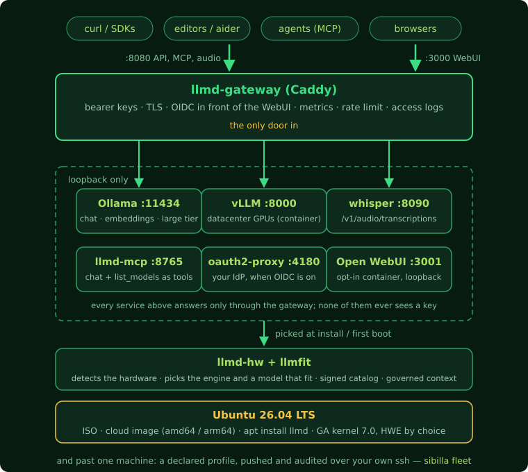

# SibillaOS

**Install Linux, get a working LLM API. Nothing leaves the machine.**

The Ubuntu-based distribution that boots into an authenticated,
OpenAI-compatible API for local models. Install it on a spare
machine, point your tools at it, and everything stays in the
building.



## What you get

A machine installed from the SibillaOS ISO (or the cloud image, or a
plain `apt install llmd` on an existing Ubuntu LTS) serves:

- an OpenAI-compatible API behind TLS and API keys, with per-IP rate
  limiting and a firewall that defaults to closed
- a curated model catalog sized to the hardware it finds: CPU-only
  boxes, consumer GPUs, and unified-memory machines each get honest
  defaults, never a model that cannot run
- chat (Open WebUI), voice transcription (whisper.cpp), embeddings
  for RAG, structured outputs, MCP, and organization login via OIDC,
  each enabled with one command
- `sibilla fleet` to manage several of these machines over SSH

Everything runs on loopback behind a single gateway. The only door is
the one you configured.

## Where to start

- [Configuration](configuration.md): every `sibilla` command, from
  `sibilla setup` to `sibilla remove`
- [Architecture](architecture.md): what runs where and why
- [Large models](large-models.md): the opt-in tier for big hardware,
  with the costs stated up front
- [Air-gapped installs](airgap.md): for machines that never see the
  internet

## Install from APT

On an existing Ubuntu LTS machine:

```console
$ curl -fsSL https://engineering87.github.io/sibillaos/apt/sibillaos-archive-key.asc \
    | sudo gpg --dearmor -o /usr/share/keyrings/sibillaos-archive-keyring.gpg
$ printf 'Types: deb\nURIs: https://engineering87.github.io/sibillaos/apt/\nSuites: ./\nSigned-By: /usr/share/keyrings/sibillaos-archive-keyring.gpg\n' \
    | sudo tee /etc/apt/sources.list.d/sibillaos.sources
$ sudo apt update && sudo apt install llmd
$ sudo sibilla setup
```

Reversible with `sudo sibilla remove`. ISOs and cloud images are on
the [releases page](https://github.com/engineering87/sibillaos/releases).

## The philosophy

The machine state is declared in one file and applied atomically.
Every capability is additive and opt-in. The catalog only carries
permissively licensed, non-gated models, each verified before it is
trusted. Big models never become defaults: the RAM floor fails
closed, and the cost is stated before the download starts.

SibillaOS is an independent project based on Ubuntu, not affiliated
with, endorsed by, or sponsored by Canonical Ltd. Ubuntu is a
registered trademark of Canonical Ltd.
